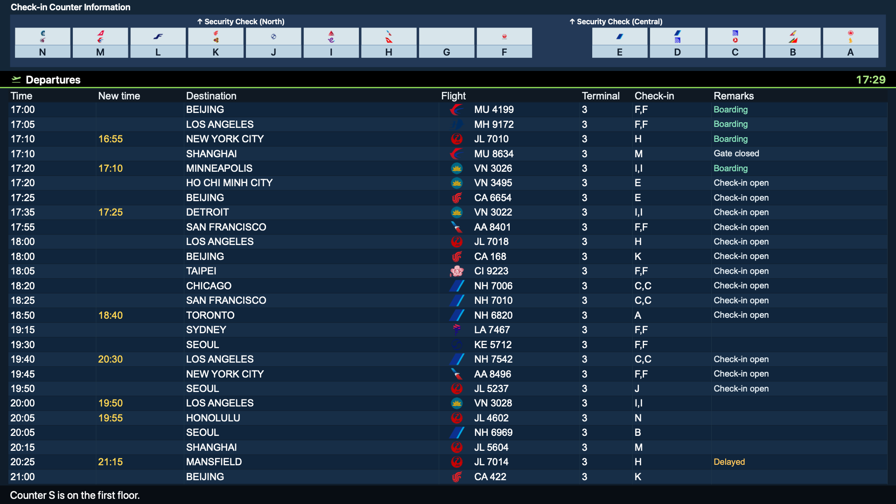
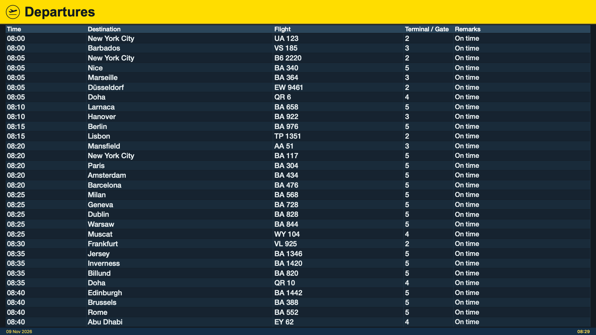
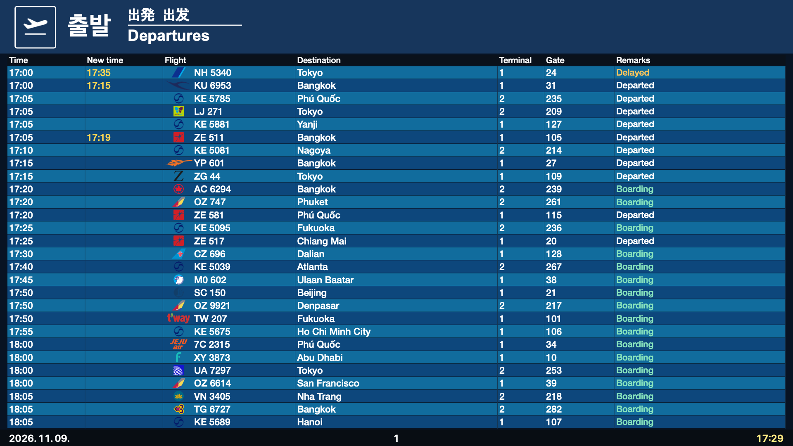

# Departure Board

**[English](README.md) · [한국어](README.ko.md)**

공항 출발 전광판을 Mac의 화면 보호기와 실시간 배경화면으로 사용할 수 있습니다. 함께 설치되는 앱에서 공항과 표시 방식을 설정합니다.

**macOS 12 이상 · Apple Silicon 및 Intel 지원 · 공항 40곳**


*Departure Board 앱의 하네다(HND) 영어 화면입니다. 항공편 데이터: [AeroDataBox](https://aerodatabox.com/).*

## Homebrew로 설치하기

```sh
brew tap Skyline-23/departure-board
brew install --cask skyline-23/departure-board/departure-board
open -a "Departure Board"
```

Homebrew가 없다면 [brew.sh](https://brew.sh/)의 안내에 따라 먼저 설치해 주세요.

Homebrew가 **Departure Board.app**을 `/Applications`에 설치하고 화면 보호기를 등록합니다. 앱을 열어 공항을 고르고 API 키를 입력하면 됩니다. **0.6.3부터 배포되는 바이너리에는 Developer ID 서명과 Apple 공증이 적용됩니다.**

<details>
<summary>이미 설치했다면 업데이트하기</summary>

```sh
brew update
brew upgrade --cask skyline-23/departure-board/departure-board
```

</details>

<details>
<summary>소스에서 빌드하거나 기존 formula 설치본 업데이트하기</summary>

```sh
brew install --formula skyline-23/departure-board/departure-board
# 이미 formula로 설치했다면 install 대신 upgrade를 사용하세요.
departure-board
```

formula는 이 Mac에서 직접 빌드하고 화면 보호기를 `~/Library/Screen Savers`에 설치합니다. 미리 빌드된 cask로 바꾸려면 formula를 먼저 제거한 뒤 `brew install --cask --force skyline-23/departure-board/departure-board`로 기존 설치본을 교체하세요. 설정은 유지됩니다.

</details>

## API 키 준비하기

실시간 항공편을 보려면 **RapidAPI를 통한 AeroDataBox 구독**과 본인의 API 키가 필요합니다. 지원 공항마다 키를 따로 만들 필요는 없습니다. 조회 가능한 데이터는 제공자의 공항별 지원 범위와 구독 요금제에 따라 달라집니다.

1. [RapidAPI](https://rapidapi.com/)에 가입하거나 로그인합니다.
2. 공식 [AeroDataBox 요금제 페이지](https://rapidapi.com/aedbx-aedbx/api/aerodatabox/pricing)에서 요금과 제공량을 확인한 뒤 구독합니다. RapidAPI 가입만으로 API 구독이 완료되지는 않습니다.
3. [Developer Dashboard](https://rapidapi.com/developer/dashboard)의 **Apps**에서 앱을 선택하고 **Authorization**을 엽니다. **X-RapidAPI-Key**에 해당하는 키 값을 복사합니다.
4. **Departure Board Settings**에서 **Timetable source → Live flight data**를 선택합니다. **API key**에 키 값을 붙여 넣고 **Apply**를 누릅니다.

가입부터 키 발급, 사용량 확인, 오류 해결까지는 **[API 키 설정 안내](docs/api-key.ko.md)**에서 확인할 수 있습니다. 무료 요금제도 결제 정보 입력을 요구할 수 있으니 구독 전에 현재 요금과 한도를 확인해 주세요.

키는 이 Mac의 키체인에 저장되며 앱에 포함되거나 프로젝트에 공유되지 않습니다. 키 없이 화면부터 살펴보려면 **Sample schedule · visual preview only**를 선택하면 됩니다.

## 화면 보호기와 배경화면으로 쓰기

- **화면 보호기:** **시스템 설정 → 배경화면 → 화면 보호기**에서 **Departure Board**를 선택합니다. 이전 macOS에서는 **화면 보호기**가 별도 항목으로 표시됩니다.
- **실시간 배경화면:** 앱 설정에서 **Set as Wallpaper**를 누릅니다. 배경화면에 자동 등록되고 모니터마다 전광판 하나가 표시됩니다.
- **메뉴 막대 앱:** 설정이나 미리보기를 열어도 Dock에 표시되지 않습니다. 미리보기 창을 닫아도 메뉴 막대에서 계속 실행됩니다. 로그인할 때 자동으로 실행하려면 **Launch in background at login**을 켜 주세요.

앱과 화면 보호기, 배경화면은 설정을 함께 사용합니다. **Show on all Spaces**를 켜면 여러 데스크탑 공간에서도 같은 전광판을 볼 수 있습니다.

## 공항마다 다른 전광판

| 히스로 · LHR | 인천 · ICN |
| --- | --- |
|  |  |

*앱에서 항공편 정보를 영어로 표시한 화면입니다. 공항 고유의 안내 표기는 유지됩니다. 항공편 데이터: [AeroDataBox](https://aerodatabox.com/).*

공항에 따라 머리글, 색상, 열 구성, 운항 상태 표시가 달라집니다. 하네다는 체크인 카운터 안내를, 히스로는 노란색 머리글을, 인천은 여러 언어로 된 출발 안내를 사용합니다. 플랩이 넘어가는 형태의 전광판도 선택할 수 있습니다.

- ICN, LHR, CDG, NRT, HND, HKG, SIN을 포함한 **공항 40곳**을 지원합니다. [전체 목록](Resources/LocationOrder.json)과 [참고한 전광판 사진](docs/visual-references.md)을 확인할 수 있습니다.
- **영어와 현지어를 번갈아 표시**할 수 있습니다. 앱 설정은 영어로 제공됩니다.
- **공동운항편은 한 줄에서 편명이 순환**합니다. 편명과 페이지가 바뀔 때는 API를 추가로 호출하지 않습니다.
- **모니터마다 전광판 하나**를 표시합니다. 글자 배율과 행 수를 조절할 수 있습니다.
- **백그라운드에서 항공편을 갱신**합니다. 이미지 캐시 크기를 제한하고 가려지거나 잠든 화면은 렌더링을 멈춥니다.

공항 전광판을 참고해 만든 독립 프로젝트이며 터미널별 화면 구성과 제공되는 운항 데이터는 다를 수 있습니다.

## 지원 플랫폼

| 플랫폼 | 상태 |
| --- | --- |
| macOS 12 이상 · Apple Silicon 및 Intel | 사용 가능 |
| Windows | 추후 공개 예정. 아직 Windows 빌드는 제공하지 않습니다. |

## 개발에 참여하기

macOS와 Xcode 명령줄 도구, Python 3가 필요합니다.

```sh
./script/build.sh
./script/validate.sh
```

소스 구조와 화면 수정, 테스트 방법은 [기여 안내](CONTRIBUTING.md)를 확인해 주세요. 릴리스는 [GitHub Actions](https://github.com/Skyline-23/homebrew-departure-board/actions)에서 빌드하고 검증합니다. [릴리스 다운로드](https://github.com/Skyline-23/homebrew-departure-board/releases)와 [버그 제보](https://github.com/Skyline-23/homebrew-departure-board/issues/new/choose)도 이용할 수 있습니다.

## 라이선스와 출처

코드와 프로젝트 로고는 **[MIT 라이선스](LICENSE)**로 배포합니다. 항공사 이미지는 각 권리자의 권리를 따르며, 자세한 내용은 [제3자 자료 안내](THIRD_PARTY_NOTICES.md)에 정리했습니다.

기여하거나 빌드를 검사할 때 항공 API 키를 제출할 필요는 없습니다. 보안 문제는 [비공개 제보 안내](SECURITY.md)를 이용해 주세요.
