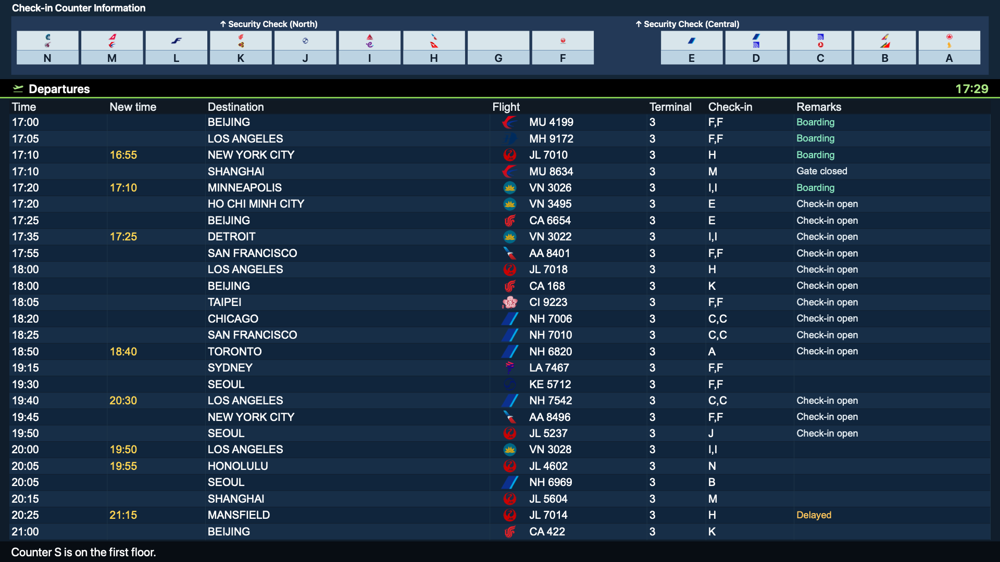
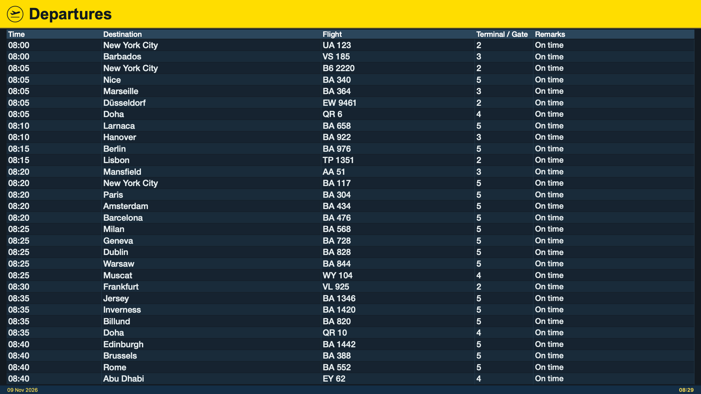
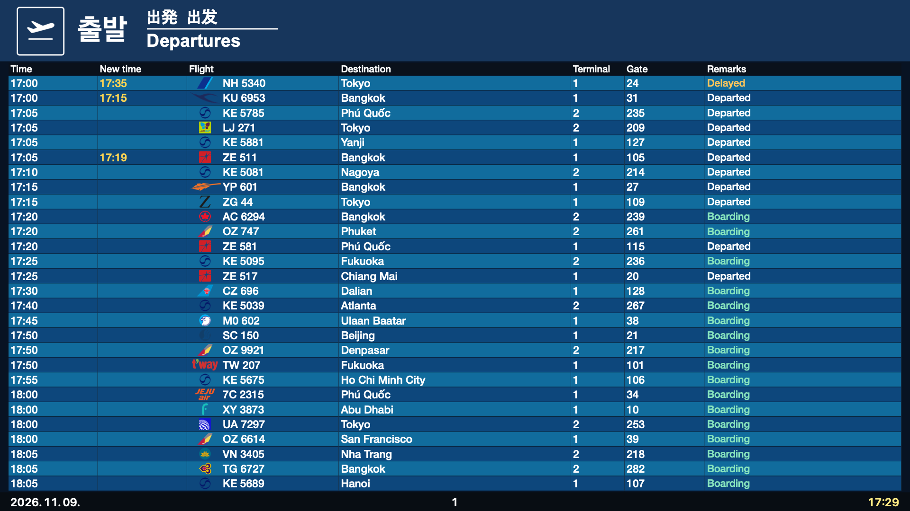

# Departure Board

**[English](README.md) · [한국어](README.ko.md)**

Airport departure boards for your Mac — a screen saver, live wallpaper and companion app.

**macOS 12+ · Apple Silicon & Intel · 40 airports**


*Haneda (HND), English — captured from Departure Board. Flight data: [AeroDataBox](https://aerodatabox.com/).*

## Install with Homebrew

```sh
brew tap Skyline-23/departure-board
brew install --cask skyline-23/departure-board/departure-board
open -a "Departure Board"
```

Need Homebrew first? Follow the instructions at [brew.sh](https://brew.sh/).

Homebrew installs **Departure Board.app** in `/Applications` and registers the screen saver. Open the app to choose an airport and add your API key. Binary releases from **0.6.3** are signed with Developer ID and notarized by Apple.

<details>
<summary>Updating an existing installation</summary>

```sh
brew update
brew upgrade --cask skyline-23/departure-board/departure-board
```

</details>

<details>
<summary>Build from source or update a previous formula installation</summary>

```sh
brew install --formula skyline-23/departure-board/departure-board
# For an existing formula installation, use brew upgrade --formula instead.
departure-board
```

The formula builds locally and installs the screen saver in `~/Library/Screen Savers`. To switch to the prebuilt cask, uninstall the formula first and use `brew install --cask --force skyline-23/departure-board/departure-board` to replace its installed bundles. Your settings are preserved.

</details>

## Get an API key

Live departures use **your own AeroDataBox subscription through RapidAPI**. One key works across the supported airports; availability depends on the provider's coverage and your plan.

1. Sign in to [RapidAPI](https://rapidapi.com/).
2. Open the official [AeroDataBox pricing page](https://rapidapi.com/aedbx-aedbx/api/aerodatabox/pricing), review the plans and subscribe to one. Creating a RapidAPI account alone does not activate this API.
3. In the [Developer Dashboard](https://rapidapi.com/developer/dashboard), open **Apps**, select an app and open **Authorization**. Copy the key used for **X-RapidAPI-Key**.
4. In **Departure Board Settings**, choose **Live flight data** under **Timetable source**, paste the value into **API key**, then select **Apply**.

For account setup, key creation, plan limits and troubleshooting, see the **[API key guide](docs/api-key.md)**. RapidAPI may require billing details for a free plan, so review the current price and quota before subscribing.

The key stays in your Mac's Keychain. It is not included in the app or shared with the project. You can try the layouts without a key by choosing **Sample schedule · visual preview only**.

## Make it your screen saver or wallpaper

- **Screen saver:** open **System Settings → Wallpaper → Screen Saver** and choose **Departure Board**. Older macOS versions have a separate **Screen Saver** settings pane.
- **Live wallpaper:** select **Set as Wallpaper** in Departure Board Settings. The app registers the board automatically and creates one live board per monitor.
- **Menu bar app:** Departure Board stays out of the Dock, including when settings or the preview are open. Close the preview to keep it running in the menu bar. Enable **Launch in background at login** if you want it to start when you sign in.

The app, screen saver and wallpaper share their settings. **Show on all Spaces** controls whether the wallpaper appears across your Spaces.

## Different airports, different boards

| Heathrow · LHR | Incheon · ICN |
| --- | --- |
|  |  |

*Application captures using English flight information. Airport-specific signage is preserved. Flight data: [AeroDataBox](https://aerodatabox.com/).*

Each airport has its own headers, colors, columns and status treatments. Haneda includes a check-in counter diagram; Heathrow uses a yellow header; Incheon keeps its multilingual signage. A split-flap style is also available.

- **40 airport profiles**, including ICN, LHR, CDG, NRT, HND, HKG and SIN. See the [full list](Resources/LocationOrder.json) and [visual references](docs/visual-references.md).
- **English and local-language display**, with automatic language rotation. Settings stay in English.
- **Codeshares in one row**, rotating flight numbers without extra API calls. Board pages rotate as well.
- **One panel per monitor**, with adjustable board scale and row density.
- **Updates in the background**, with bounded image caches and rendering paused on sleeping or covered displays.

These are independent recreations of airport displays; layout and live-data coverage can vary by terminal and provider.

## Platforms

| Platform | Status |
| --- | --- |
| macOS 12 or later · Apple Silicon and Intel | Available |
| Windows | [Preview port](Windows/README.md): x64/ARM64 builds in the Windows preview workflow; unsigned |

## Development

Requires macOS, Xcode command-line tools and Python 3.

```sh
./script/build.sh
./script/validate.sh
```

See [Contributing](CONTRIBUTING.md) for the source layout, visual changes and testing. Releases are built and checked with [GitHub Actions](https://github.com/Skyline-23/homebrew-departure-board/actions). [Download releases](https://github.com/Skyline-23/homebrew-departure-board/releases) or [report a bug](https://github.com/Skyline-23/homebrew-departure-board/issues/new/choose).

## License and credits

Code and project branding: **[MIT](LICENSE)**. Airline artwork retains its own rights; see [Third-party notices](THIRD_PARTY_NOTICES.md).

Flight API credentials are never required for contributions or build checks. Please use [private reporting](SECURITY.md) for security issues.
