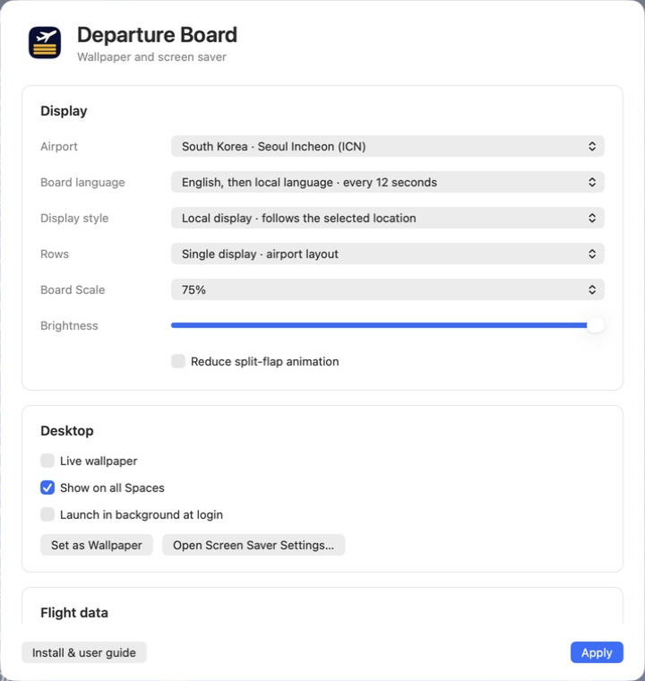
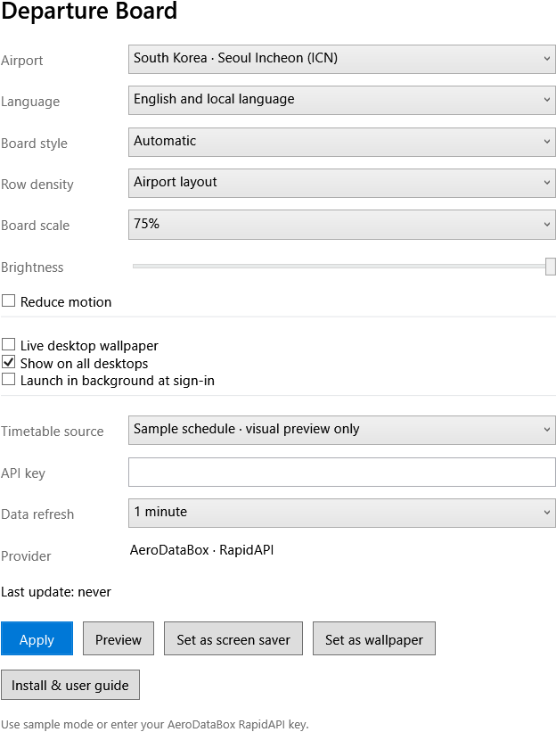
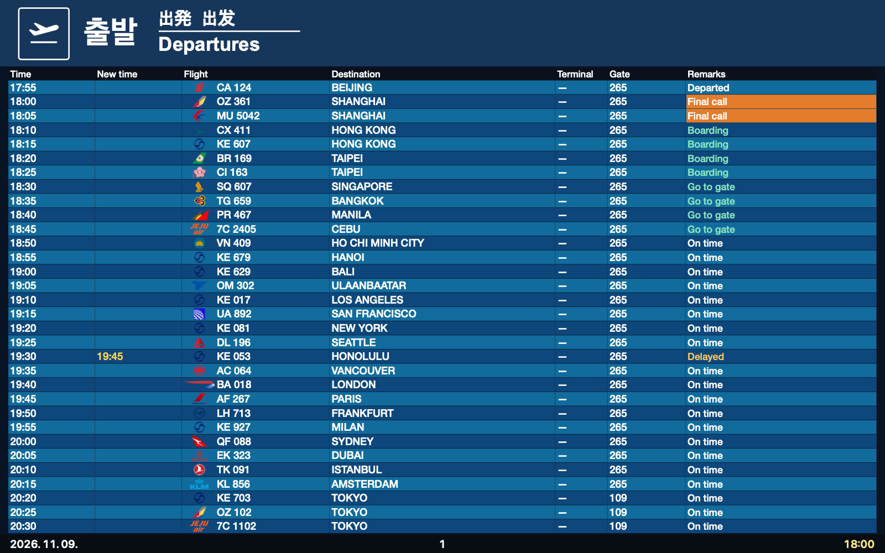
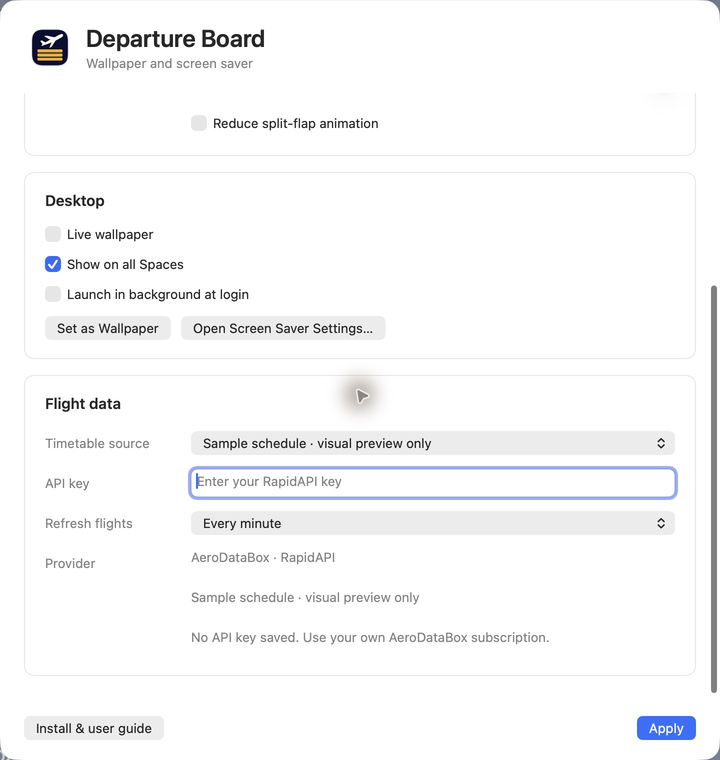
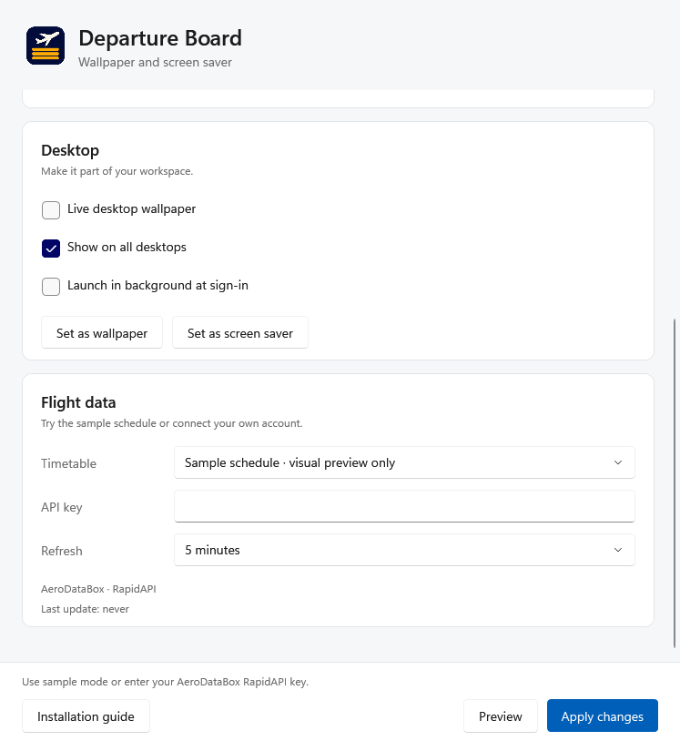
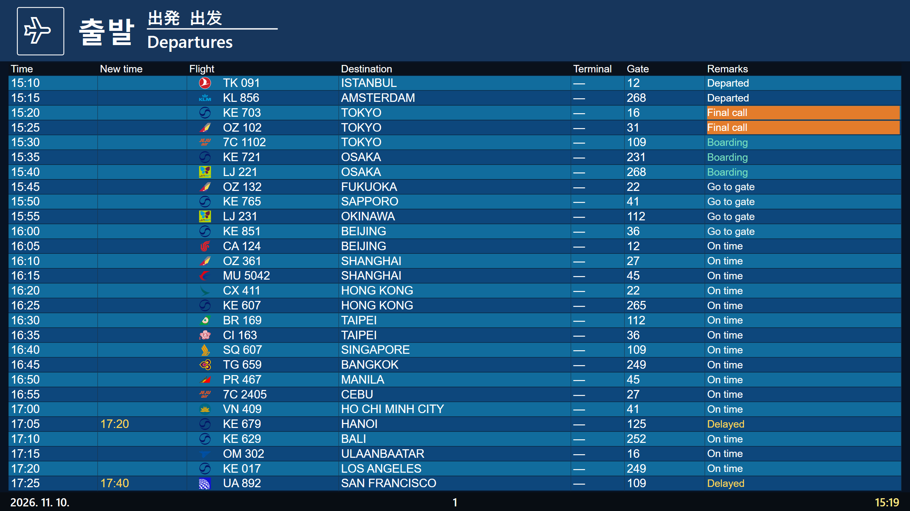

# Departure Board 설치와 사용 설명서

공항 전광판을 **움직이는 배경화면**, **화면 보호기**, **미리보기 창**으로 사용하는 앱입니다. 이 설명서는 macOS와 Windows의 설치부터 설정, 여러 모니터, 업데이트와 문제 해결까지 안내합니다.

> 처음에는 API 키 없이 **Sample schedule**로 화면을 확인하세요. 실제 항공편이 필요할 때만 본인의 AeroDataBox 구독과 API 키를 연결하면 됩니다. 샘플 시간표는 실제 운항 정보가 아닙니다.

## 1. 내 컴퓨터에 맞는 파일 고르기

| 컴퓨터 | 받을 파일 | 지원 범위 |
| --- | --- | --- |
| Mac — Apple Silicon 또는 Intel | `DepartureBoard-universal.dmg` 또는 Homebrew cask | macOS 12 이상. Apple Silicon·Intel 공용, Developer ID 서명과 Apple 공증 적용 |
| Windows — Intel 또는 AMD CPU | `DepartureBoard-win-x64-Setup.exe` | Windows 11. 서명 없는 프리뷰 |
| Windows — Snapdragon 등 ARM CPU | `DepartureBoard-win-arm64-Setup.exe` | Windows 11 ARM64. 서명 없는 프리뷰 |

[제품 페이지](https://dpboard.skyline23.com/ko.html)의 **설치하기** 또는 **받기**를 누르면 현재 컴퓨터에 맞는 최신 설치 파일을 받습니다. Mac은 DMG, Windows는 x64 또는 ARM64용 EXE입니다. 버튼 아래에서 감지된 운영체제를 확인하세요. **혹시 이 운영체제가 아닌가요?**를 누르면 직접 선택할 수 있습니다.

Windows의 **설정 → 시스템 → 정보 → 시스템 종류**에서 x64 또는 ARM 기반 프로세서인지 확인할 수 있습니다. Windows 설치 파일에 .NET 런타임이 포함되어 있습니다.

DMG 안의 **Install Guide.html**, Mac 앱의 **Install & user guide**, Windows 앱의 **Installation guide**에서 이 설명서를 다시 열 수 있습니다. 설명과 사진은 앱에 들어 있어 오프라인에서도 읽을 수 있습니다.

## 2. macOS에 설치하기

### Homebrew로 설치

1. 터미널을 엽니다. Homebrew가 없다면 [brew.sh](https://brew.sh/)의 공식 설치 안내를 먼저 따릅니다.
2. 아래 명령을 순서대로 실행합니다.

```sh
brew tap Skyline-23/departure-board
brew install --cask skyline-23/departure-board/departure-board
open -a "Departure Board"
```

3. **Departure Board Settings**가 열리는지 확인합니다. 앱은 메뉴 막대에서 실행되므로 Dock에 아이콘이 없어도 정상입니다.
4. 아래의 ‘첫 화면 설정’ 순서대로 샘플 화면부터 확인합니다.

Homebrew는 앱을 `/Applications`에 설치하고 화면 보호기를 등록합니다. 회사에서 Homebrew 사용을 제한한다면 관리자 정책을 먼저 확인하세요.

### DMG로 직접 설치

1. **DepartureBoard-universal.dmg**를 열면 Finder에 설치 디스크가 나타납니다.
2. **Departure Board.app**을 같은 창의 **Applications**로 드래그합니다.
3. **Departure Board.saver**를 더블클릭하고 macOS의 화면 보호기 설치 안내를 따릅니다.
4. 응용 프로그램 폴더의 **Departure Board**를 실행합니다. 설치 디스크에서 바로 실행하지 마세요.
5. 앱이 열리면 Finder에서 **Departure Board** 설치 디스크를 추출합니다. 다음부터는 응용 프로그램 폴더에서 실행합니다.

앱과 화면 보호기는 같은 버전으로 함께 설치합니다. 이전 ZIP 배포본은 압축을 푼 뒤 2~4번 순서를 따릅니다.

## 3. Windows에 설치하기

1. CPU에 맞는 **Setup.exe**를 다운로드하고 더블클릭합니다. 압축을 풀거나 .NET을 따로 설치할 필요가 없습니다.
2. 설치 안내에 따라 **설치**를 누릅니다. 완료 화면에서 Departure Board 실행을 선택합니다.
3. 설치가 완료되면 **Departure Board** 설정창이 열리는지 확인합니다. 이후에는 시작 메뉴에서 **Departure Board**를 검색해 실행합니다.
4. 작업 표시줄의 숨겨진 아이콘 영역에 비행기 아이콘이 있는지 확인합니다. 설정창을 닫아도 앱은 이 영역에서 계속 실행됩니다.

설치는 현재 사용자에게 적용되며 관리자 권한이 필요하지 않습니다. 기본 위치는 `%LOCALAPPDATA%\Programs\DepartureBoard`입니다. 시작 메뉴 바로가기를 만들고 Departure Board를 화면 보호기로 선택하지만, 유휴 대기 시간과 잠금 옵션은 Windows 설정에서 직접 정합니다.

> Windows 버전은 **서명 없는 프리뷰**입니다. 알 수 없는 게시자 경고가 보일 수 있습니다. 공식 릴리스에서 받은 파일인지와 SHA-256을 먼저 확인하세요. 조직 정책으로 실행이 막히면 보안 기능을 끄지 말고 관리자에게 문의하세요.

### 다운로드 무결성 확인

설치 파일에 맞는 체크섬 파일도 받습니다: [Windows x64](https://dpboard.skyline23.com/download/windows-x64-setup.sha256), [Windows ARM64](https://dpboard.skyline23.com/download/windows-arm64-setup.sha256). PowerShell에서 다음 명령을 실행한 뒤 나온 해시를 `.sha256` 파일의 첫 값과 비교합니다. ARM64 파일은 명령의 파일명을 바꾸면 됩니다.

```powershell
Get-FileHash "$env:USERPROFILE\Downloads\DepartureBoard-win-x64-Setup.exe" -Algorithm SHA256
```

## 4. 첫 화면 설정



*macOS 설정창. Display에서 전광판을 고르고, Desktop에서 배경화면을 설정합니다. 아래로 스크롤하면 Flight data가 나옵니다.*



*Windows 설정창. Display·Desktop·Flight data로 항목을 나눴습니다. 아래의 Preview와 Apply changes 버튼은 스크롤해도 보입니다.*

1. **Airport**에서 보고 싶은 공항을 선택합니다. 예: Seoul Incheon (ICN), Tokyo Haneda (HND), London Heathrow (LHR).
2. **Flight data**의 **Timetable / Timetable source → Sample schedule · visual preview only**를 선택합니다. 키 없이 화면과 레이아웃을 확인하는 모드입니다.
3. **Language / Board language**에서 영어, 현지어 또는 두 언어 번갈아 표시를 고릅니다.
4. Mac은 **Apply**, Windows는 **Apply changes**를 누릅니다. Windows에서는 **Preview**, Mac에서는 메뉴 막대의 **Show Board**로 전광판을 확인합니다.
5. 표시가 마음에 들면 배경화면 또는 화면 보호기로 설정합니다. 실제 항공편 연결은 다음 항목을 참고하세요.

## 5. 배경화면과 화면 보호기

### 움직이는 배경화면

**Desktop**에서 **Live wallpaper**(Mac) 또는 **Live desktop wallpaper**(Windows)를 켭니다. Mac은 **Apply**, Windows는 **Apply changes**를 누르면 적용됩니다. 전광판이 바탕화면 아이콘 뒤에서 갱신됩니다. 앱이 실행 중이어야 계속 움직이며, 완전히 종료하면 움직이는 전광판도 사라집니다.

**Show on all Spaces / Show on all desktops**는 여러 가상 데스크톱에 표시할지를 정합니다. 여러 물리 모니터를 하나의 가로로 긴 전광판으로 합치는 옵션은 아닙니다. 각 모니터에는 별도의 전광판이 표시됩니다.

로그인할 때도 계속 쓰려면 **Launch in background at login / sign-in**을 켭니다. 배경화면이 필요 없으면 Live wallpaper를 끄고 Apply를 누르세요.

Wallpaper Engine 등 다른 배경화면 앱이 실행 중이면 Departure Board가 가려질 수 있습니다. 배경화면을 관리하는 앱 하나만 재생하도록 설정한 뒤 확인하세요.

### 정지 배경화면

**Set as Wallpaper**는 현재 전광판을 정지 이미지로 저장해 시스템 배경화면으로 지정합니다. 이 이미지는 앱을 종료해도 남지만, 이후 시간과 항공편은 갱신되지 않습니다. 움직이는 화면이 목적이라면 Live wallpaper를 사용하세요.

전광판의 머리글과 마지막 줄은 메뉴 막대·Dock·작업 표시줄의 사용 영역을 피해 배치됩니다. 배경화면의 바깥 여백은 이를 위한 공간입니다. Windows의 정지 이미지는 생성 당시 모니터 배치에 맞춰지므로 모니터 구성이나 해상도를 바꾼 뒤에는 다시 **Set as Wallpaper**를 누릅니다.

### 화면 보호기

**macOS** 설정창의 **Open Screen Saver Settings…**를 누르거나 시스템 설정에서 ‘화면 보호기’를 검색합니다. **Departure Board**를 선택하고 시스템의 미리보기로 확인합니다. 시작까지의 대기 시간과 잠금 설정은 macOS에서 정합니다.

**Windows** 앱에서 **Set as screen saver**를 누릅니다. Windows 시작 메뉴에서 ‘화면 보호기 변경’을 검색해 **DepartureBoard**가 선택되어 있는지 확인하고 **미리 보기**를 누릅니다. **대기 시간**과 **다시 시작할 때 로그온 화면 표시**를 원하는 값으로 정한 뒤 적용합니다.

화면 보호기는 전체 화면을 사용합니다. 키를 누르거나 마우스를 움직이면 종료됩니다. 설정창의 Preview는 일반 창이며, Windows 시스템의 화면 보호기 Preview와 다릅니다.



*샘플 시간표 예시. 페이지·언어·공동운항 편명이 순환하므로 한 화면에 모든 항공편이 동시에 보이지 않을 수 있습니다.*

## 6. 실제 항공편 연결



*Mac의 Flight data. 샘플 시간표와 실시간 항공편을 선택하고 API 키와 갱신 주기를 설정합니다.*



*Windows의 Flight data. 키를 저장한 뒤에는 다시 입력하지 않아도 됩니다. 사진에는 키가 없습니다.*

1. [RapidAPI](https://rapidapi.com/)에 로그인합니다.
2. [AeroDataBox 요금제](https://rapidapi.com/aedbx-aedbx/api/aerodatabox/pricing)를 확인하고 필요한 구독을 활성화합니다. RapidAPI 계정만 만드는 것으로는 API 구독이 완료되지 않습니다.
3. RapidAPI의 Developer Dashboard에서 앱의 **X-RapidAPI-Key**를 복사합니다.
4. **Flight data**의 **Timetable / Timetable source**에서 **Live flight data**를 고르고 **API key**에 키를 넣습니다. Mac은 **Apply**, Windows는 **Apply changes**를 누릅니다.
5. **Last update**가 갱신되고 실제 항공편이 나타나는지 확인합니다. 데이터가 없다는 표시와 키·구독 오류 표시는 의미가 다릅니다.

키는 macOS Keychain 또는 Windows Credential Manager에 저장됩니다. 프로젝트에 전송하거나 공유하지 않습니다. 저장된 키가 점으로 표시되어 있으면 다시 붙여 넣을 필요가 없습니다. 스크린샷이나 오류 제보에 키를 포함하지 마세요.

**Data refresh / Refresh flights**는 API 조회 주기입니다. 새로 설치하면 기본값은 5분이며, 기존에 고른 주기는 유지됩니다. 자주 조회할수록 요금제 할당량을 더 빨리 사용할 수 있습니다. 언어·페이지·공동운항 편명 전환에는 새 API 요청이 필요하지 않습니다. 앱과 화면 보호기는 캐시와 요청 잠금을 공유합니다. 제공사가 오류를 반환하면 공항을 바꿔도 같은 실패 요청을 반복하지 않고 재시도 대기를 공유합니다. 미리 보기·설정·움직이는 배경화면 없이 트레이나 메뉴 막대에만 있는 앱은 항공편을 계속 조회하지 않습니다. 제공사의 실제 요금과 한도를 확인하고 설정하세요.

## 7. 모든 표시 옵션

| 옵션 | 선택값 / 동작 | 이렇게 조절하세요 |
| --- | --- | --- |
| Airport | 공항 40곳 | 공항마다 열과 색상 구성이 다릅니다 |
| Board style / Display style | Automatic, LCD, Split-flap | Automatic은 해당 공항의 레이아웃을 사용합니다 |
| Language / Board language | 영어, 현지어, 번갈아 | 번갈아 모드는 자동 전환됩니다 |
| Row density / Rows | Airport layout, 10, 12, 16 | 글씨가 작으면 행 수를 줄여 보세요 |
| Board scale | 50, 65, 75, 85, 100% | 높이면 내용이 더 크게 보입니다. Windows의 화면 배율과 별도입니다 |
| Brightness | 35–100% | 야간에는 낮게 조절할 수 있습니다 |
| Reduce motion | 전환 효과 줄이기 | 페이지와 데이터 갱신은 계속됩니다 |
| Data refresh | 1분, 5분, 15분, 1시간, 6시간 | API 요금제에 맞춰 선택합니다 |
| Launch in background | 로그인 후 자동 실행 | 설정창을 자동으로 띄우는 옵션은 아닙니다 |
| Show on all desktops / Spaces | 가상 데스크톱 전체 표시 | 물리 모니터 확장 모드와 다릅니다 |

공항에 따라 표시하지 않는 열이 있습니다. 출발 시각, 게이트, 체크인 카운터가 빈칸 또는 대시이면 제공된 데이터가 없을 수 있습니다. 화면의 항공편 상태는 실제 공항 안내를 대체하지 않습니다.

## 8. 여러 모니터와 서로 다른 배율

Windows의 **설정 → 시스템 → 디스플레이**에서 각 화면을 선택해 해상도와 배율을 확인합니다. 예를 들어 4K 화면 150%와 FHD 화면 100%처럼 서로 다른 배율을 쓰는 구성이 ‘혼합 DPI’입니다. 앱의 Board scale과 Windows의 화면 배율은 서로 다른 설정입니다.

1. Windows의 표시 모드를 **확장**으로 설정합니다. 복제 모드는 같은 화면을 반복하므로 독립된 두 화면 검증이 아닙니다.
2. **식별**을 눌러 화면 번호를 확인하고, 실제 위치에 맞게 왼쪽·오른쪽·위아래로 배치합니다. 주 모니터 왼쪽이나 위쪽 화면도 사용할 수 있습니다.
3. 각 화면에서 Live wallpaper의 머리글, 마지막 행, 날짜·시간이 잘리지 않는지 확인합니다. 작업 표시줄을 옮긴 뒤에도 확인합니다.
4. Windows 화면 보호기 미리보기를 시작해 모든 화면이 채워지고 마우스 입력으로 정상 종료되는지 확인합니다.
5. 앱의 Preview 창을 화면 사이로 옮겨 글자가 흐려지거나 내용이 창 밖으로 밀려나지 않는지 확인합니다.
6. 모니터를 연결·분리하거나 해상도를 바꾼 뒤 정지 배경화면을 쓰고 있다면 다시 적용합니다.

가상 디스플레이로 확인한 결과와 물리 모니터에서 확인한 결과는 [검증 기록](https://github.com/Skyline-23/homebrew-departure-board/blob/main/Windows/VALIDATION.md)에 구분해 기록합니다. 원격 데스크톱 한 화면의 해상도를 키우는 것만으로는 실제 다중 모니터나 혼합 DPI를 검증한 것이 아닙니다.



*2560×1440, 200% 배율의 가상 화면에서 캡처했습니다. 1920×1080, 100% 화면과 동시에 검증했으며, 물리 모니터 촬영 사진은 아닙니다.*

## 9. 업데이트와 제거

**앱에서 업데이트하기 (0.7.7 이상)** Mac 메뉴 막대의 **Check for Updates…**, Windows 설정 또는 트레이 메뉴의 **Check for updates…**를 누르세요. 설정의 Updates에서 자동 확인을 끄거나 켤 수 있고, 마지막 확인 시각과 현재 버전을 볼 수 있습니다. 자동 확인은 기본으로 켜져 있으며 하루 한 번 새 버전을 확인합니다. 자동 업데이트는 기본으로 꺼져 있습니다. 켜면 파일을 미리 내려받고 앱을 종료할 때 설치합니다. Windows에서는 트레이의 Quit으로 종료하세요. 설치를 선택하면 서명을 확인한 파일을 내려받아 앱을 교체하고 다시 실행합니다. 설정과 저장된 API 키는 유지됩니다. Mac의 설치된 화면 보호기는 새 앱이 실행될 때 함께 갱신됩니다.

0.7.6 이하를 사용 중이라면 아래 방법으로 최신 버전을 한 번 설치하세요. 그다음부터는 앱 안에서 업데이트할 수 있습니다. 인터넷 연결이 없어도 기존 앱은 계속 사용할 수 있으며, 연결 후 다시 확인하면 됩니다.

**Mac / Homebrew** 아래 명령으로 업데이트합니다. 설정과 키를 새로 입력할 필요는 없습니다.

```sh
brew update
brew upgrade --cask skyline-23/departure-board/departure-board
```

**Mac / DMG** 앱을 종료하고 새 DMG를 엽니다. 앱을 Applications로 드래그해 교체하고 `.saver`도 다시 설치합니다. 설치 디스크를 추출한 뒤 응용 프로그램 폴더의 앱을 실행합니다.

**Windows** 새 버전의 **Setup.exe**를 실행하면 기존 설치가 업데이트됩니다. 설정과 API 키는 유지됩니다.

**Windows 제거** **설정 → 앱 → 설치된 앱 → Departure Board → 제거**를 선택합니다. 현재 화면 보호기가 Departure Board이면 이전 선택을 복원합니다. 사용자 설정과 API 키는 유지됩니다. 완전히 지우려면 앱을 종료한 뒤 `%LOCALAPPDATA%\DepartureBoard`와 Credential Manager의 Departure Board 항목을 별도로 정리합니다.

**Mac 제거** Homebrew로 설치했다면 `brew uninstall --cask skyline-23/departure-board/departure-board`를 실행합니다. DMG로 설치했다면 응용 프로그램 폴더의 앱과 설치한 화면 보호기를 제거합니다. 일반 제거는 사용자 설정과 키를 유지합니다.

## 10. 문제가 생겼을 때

| 증상 | 먼저 확인할 것 |
| --- | --- |
| 설치 안내가 열리지 않음 | 앱의 Installation guide 또는 Install & user guide를 누릅니다. DMG에서는 `Install Guide.html`과 `Guide` 폴더를 같은 위치에 둡니다 |
| 앱 창을 닫았는데 계속 움직임 | 정상입니다. 메뉴 막대 또는 트레이에서 Quit을 선택해야 완전히 종료됩니다 |
| 화면 보호기 목록에 없음 | Mac은 `.saver`를 설치했는지, Windows는 Setup.exe로 설치했는지 확인합니다. Windows의 Set as screen saver도 사용할 수 있습니다 |
| 실제 항공편이 나오지 않음 | Sample/Live 선택, AeroDataBox 구독, API 키, 인터넷, Last update를 확인합니다 |
| 401 / 403 / 429 | 각각 키 인증, 구독·권한, 요청 한도 문제일 수 있습니다. 제공사 계정에서 확인합니다 |
| 계속 Loading 또는 No departures | 조회 완료 여부와 공항별 제공 데이터를 확인합니다. 샘플 모드가 정상인지 먼저 비교합니다 |
| 배경화면이 정지함 | Live wallpaper가 켜져 있고 앱이 실행 중인지 확인합니다. Set as Wallpaper만 누르면 정지 이미지입니다 |
| 정지 배경화면이 잘림 | 모니터 구성·배율·작업 표시줄 변경 후 앱에서 정지 배경화면을 다시 적용합니다 |
| Windows 앱이 실행되지 않음 | x64/ARM64 설치 파일 선택과 조직 실행 정책을 확인합니다 |

오류를 제보할 때는 앱 버전, OS 버전, 재현 순서, 화면별 해상도·배율·배치와 **API 키가 보이지 않는** 사진을 함께 보내세요. 로그 위치와 진단 항목은 [진단 안내](https://github.com/Skyline-23/homebrew-departure-board/blob/main/docs/diagnostics.md)에 있습니다. 로그를 공개하기 전에 개인 정보가 없는지 확인하세요.
