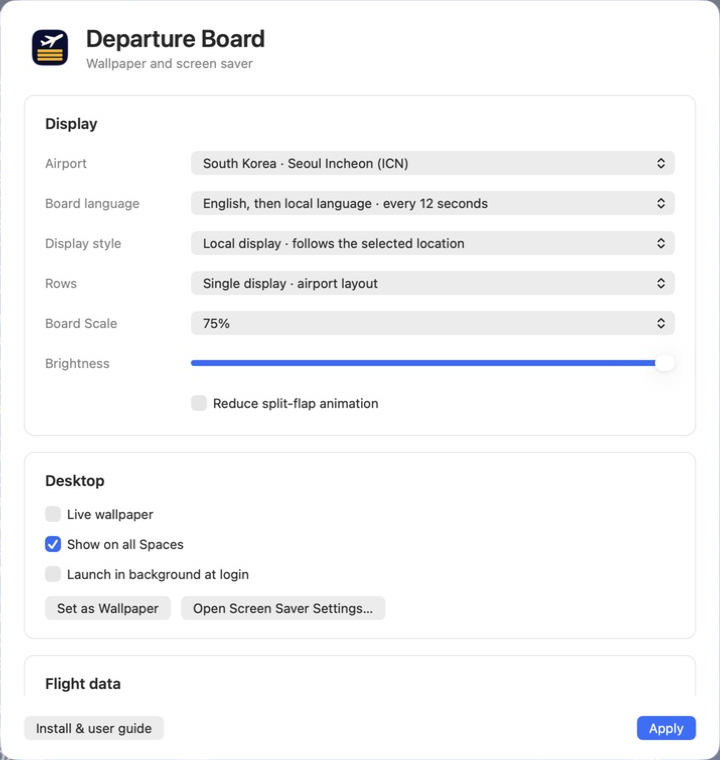
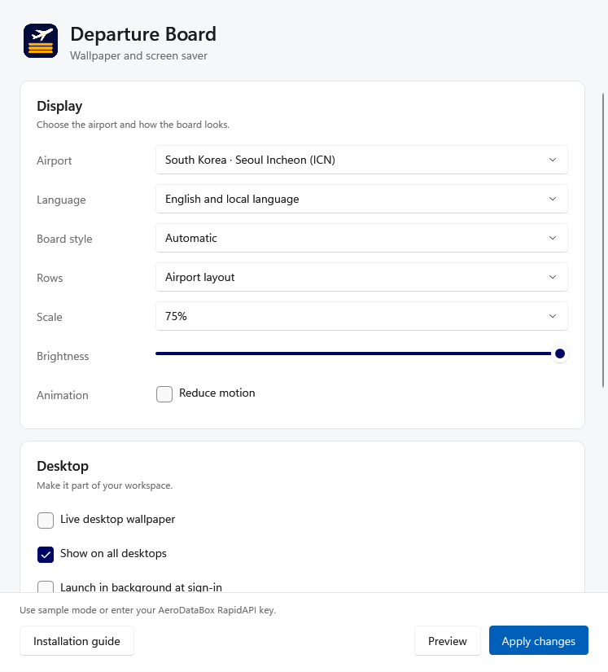
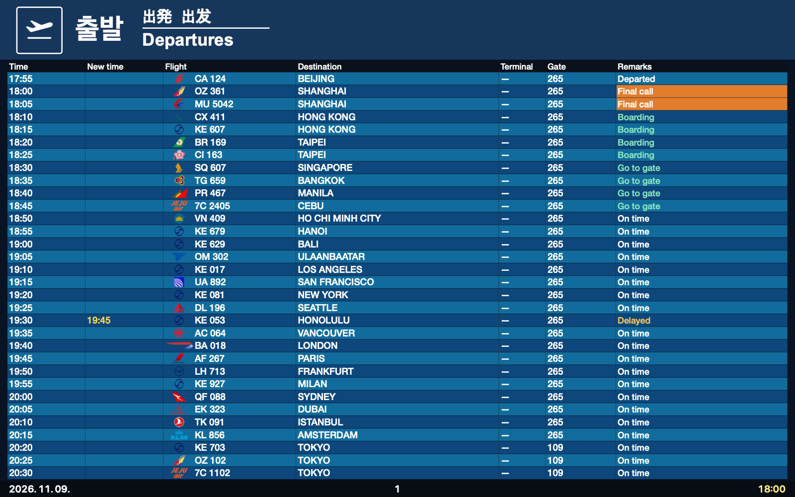
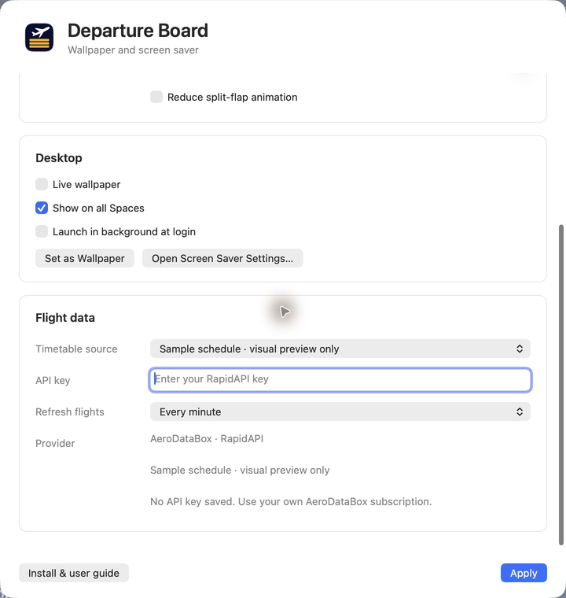
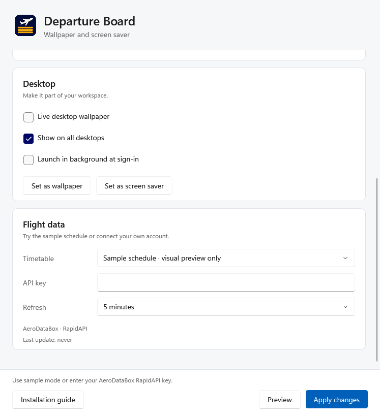
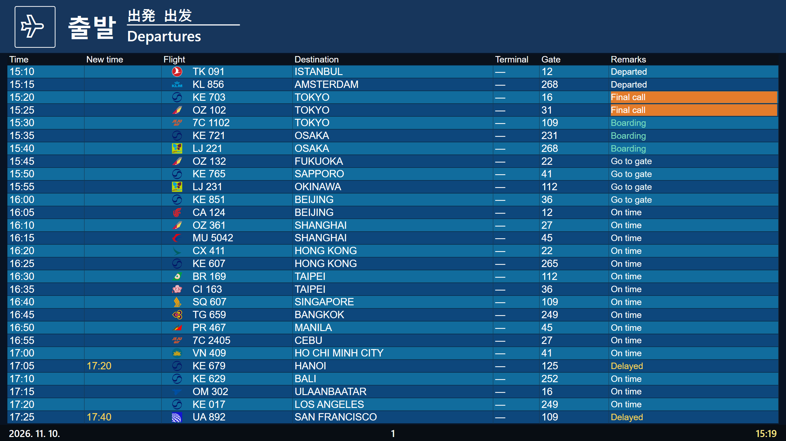

# Departure Board installation and user guide

Use an airport departure board as a **live desktop wallpaper**, **screen saver**, or **preview window**. This guide covers installation, settings, multiple displays, updates and troubleshooting on macOS and Windows.

> Start with **Sample schedule**, which needs no API key. Connect your own AeroDataBox subscription only when you want real flights. The sample schedule is fictional and is not operational flight information.

## 1. Choose your download

| Computer | Download | Support |
| --- | --- | --- |
| Mac, Apple Silicon or Intel | `DepartureBoard-universal.dmg`, or the Homebrew cask | macOS 12+, Apple Silicon and Intel. Developer ID signed and notarized |
| Windows, Intel or AMD CPU | `DepartureBoard-win-x64-Setup.exe` | Windows 11, unsigned preview |
| Windows, ARM CPU such as Snapdragon | `DepartureBoard-win-arm64-Setup.exe` | Windows 11 ARM64, unsigned preview |

Select **Install** or **Get** on the [product page](https://dpboard.skyline23.com/) to download the latest installer for your computer. macOS uses a DMG. Windows uses an x64 or ARM64 EXE. The detected platform appears below the button. Select **Need a different operating system?** to choose manually.

On Windows, open **Settings → System → About → System type** to identify your processor. The installer includes the .NET runtime.

Open **Install Guide.html** on the mounted Mac disk image, **Install & user guide** in the Mac app, or **Installation guide** in the Windows app. The text and pictures are bundled with the app and work offline.

## 2. Install on macOS

### Using Homebrew

1. Open Terminal. If Homebrew is missing, follow its official instructions at [brew.sh](https://brew.sh/).
2. Run these commands in order.

```sh
brew tap Skyline-23/departure-board
brew install --cask skyline-23/departure-board/departure-board
open -a "Departure Board"
```

3. Check that **Departure Board Settings** opens. The app lives in the menu bar and intentionally has no Dock icon.
4. Follow the first-run steps below to try a sample board.

Homebrew installs the app in `/Applications` and registers the screen saver. Follow your organization's policy if Homebrew is restricted.

### Using the DMG

1. Open **DepartureBoard-universal.dmg**. Finder shows the installation disk.
2. Drag **Departure Board.app** to **Applications** in the same window.
3. Double-click **Departure Board.saver** and follow the macOS screen-saver installation dialog.
4. Open **Departure Board** from Applications.
5. Eject the **Departure Board** installation disk. Continue launching the installed app from Applications.

Update the app and screen saver together. For an older ZIP release, extract it and follow steps 2–4.

## 3. Install on Windows

1. Download and open **Setup.exe** for your CPU. No archive extraction or separate .NET installation is needed.
2. Follow the setup wizard and choose **Install**. On the final page, choose to launch Departure Board.
3. Check that the **Departure Board** settings window opens. Later, search for **Departure Board** in Start.
4. Find the airplane icon in the taskbar's notification area, including its hidden icons. Closing settings leaves the app running there.

Installation is per-user and does not require administrator access. The default folder is `%LOCALAPPDATA%\Programs\DepartureBoard`. It creates a Start shortcut and selects Departure Board as the screen saver. Set its idle timeout and sign-in behavior in Windows separately.

> Windows is an **unsigned preview** and may show an unknown-publisher warning. Verify that the file came from the official release and compare its SHA-256. If organization policy blocks it, contact your administrator instead of disabling security controls.

### Verify the download

Download the matching checksum: [Windows x64](https://dpboard.skyline23.com/download/windows-x64-setup.sha256) or [Windows ARM64](https://dpboard.skyline23.com/download/windows-arm64-setup.sha256). In PowerShell, run the following and compare the returned hash with the first value in that file. Substitute the ARM64 filename when applicable.

```powershell
Get-FileHash "$env:USERPROFILE\Downloads\DepartureBoard-win-x64-Setup.exe" -Algorithm SHA256
```

## 4. Set up the first board



*macOS settings. Display controls the board, Desktop controls wallpaper, and Flight data appears below when you scroll.*



*Windows settings use Display, Desktop and Flight data sections. Preview and Apply changes stay visible while scrolling.*

1. Choose an **Airport**, such as Seoul Incheon (ICN), Tokyo Haneda (HND), or London Heathrow (LHR).
2. Under **Flight data**, set **Timetable / Timetable source → Sample schedule · visual preview only** to try the layouts without a key.
3. Choose English, local language, or alternating languages under **Language / Board language**.
4. Select **Apply** on Mac or **Apply changes** on Windows. On Windows, select **Preview**; on Mac, use **Show Board** in the menu bar.
5. Once the preview looks right, enable wallpaper or choose the screen saver. Connect live data using section 6 if needed.

## 5. Wallpaper and screen saver

### Live wallpaper

Under **Desktop**, enable **Live wallpaper** (Mac) or **Live desktop wallpaper** (Windows). Select **Apply** on Mac or **Apply changes** on Windows. The board updates behind desktop icons while the app runs. Quitting the app removes its live desktop windows.

**Show on all Spaces / Show on all desktops** controls virtual desktops. It does not combine physical monitors into one stretched board. Each physical monitor receives its own board.

Enable **Launch in background at login / sign-in** to resume the app after signing in. To stop live wallpaper, turn off its checkbox and apply.

Another wallpaper app, such as Wallpaper Engine, can cover Departure Board. Use one active wallpaper manager at a time when checking the desktop.

### Still wallpaper

**Set as Wallpaper** saves the current board as a system wallpaper image. It remains after the app quits, but its time and flights do not update. Use Live wallpaper for an updating board.

Desktop board content leaves room for the menu bar, Dock or taskbar. The outer margin is intentional. A Windows still image is fitted to the monitor layout when created, so apply it again after changing resolution or monitor arrangement.

### Screen saver

**macOS** select **Open Screen Saver Settings…** in settings, or search for “screen saver” in System Settings. Choose **Departure Board** and try the system preview. Set the idle timeout and lock behavior in macOS.

**Windows** select **Set as screen saver** in the app. Search Start for **Change screen saver**, confirm **DepartureBoard** is selected, and choose **Preview**. Set **Wait** and **On resume, display logon screen**, then apply.

The screen saver fills the screen and exits on keyboard or mouse input. The app's Preview button opens a normal window; it is separate from the Windows screen-saver preview.



*Sample data. Pages, languages and codeshare numbers rotate, so a single image does not show the whole timetable.*

## 6. Connect real flights



*Mac Flight data settings show the schedule source, API key and refresh interval.*



*Windows Flight data settings. A saved key does not need to be entered again. No key is shown here.*

1. Sign in to [RapidAPI](https://rapidapi.com/).
2. Review [AeroDataBox plans](https://rapidapi.com/aedbx-aedbx/api/aerodatabox/pricing) and activate the subscription you need. Creating a RapidAPI account alone does not activate this API.
3. In RapidAPI's Developer Dashboard, copy your app's **X-RapidAPI-Key**.
4. Under **Flight data**, choose **Live flight data** in **Timetable / Timetable source** and paste the key into **API key**. Select **Apply** on Mac or **Apply changes** on Windows.
5. Check that **Last update** advances and real flights appear. An empty schedule is different from a key or subscription error.

Keys are stored in macOS Keychain or Windows Credential Manager, not shared with the project. A masked saved key does not need to be pasted again. Never include a key in screenshots or bug reports.

**Data refresh / Refresh flights** controls the API request interval. New installations default to 5 minutes; saved choices stay unchanged. Frequent requests can consume your plan's allowance faster. Language, page and codeshare changes do not require extra API calls. The app and screen saver share cached flights and a request lock. When the provider returns an error, its retry delay is shared across airports, so switching airports does not repeat a failed request. A tray/menu-bar app without a visible preview, settings window or live wallpaper does not continuously fetch flights. Check the provider's current prices and limits before choosing a plan or interval.

## 7. Display settings reference

| Setting | Choices or behavior | Guidance |
| --- | --- | --- |
| Airport | 40 profiles | Columns and colors vary by airport |
| Board style / Display style | Automatic, LCD, Split-flap | Automatic uses the selected airport's layout |
| Language / Board language | English, local, alternating | Alternating switches automatically |
| Row density / Rows | Airport layout, 10, 12, 16 | Reduce rows if text is too small |
| Board scale | 50, 65, 75, 85, 100% | Higher values enlarge content; separate from Windows display scaling |
| Brightness | 35–100% | Lower it for a dimmer desktop |
| Reduce motion | Reduce transition effects | Data and page updates continue |
| Data refresh | 1, 5, 15 minutes, 1 or 6 hours | Choose to fit your provider plan |
| Launch in background | Start after signing in | Does not automatically open settings |
| Show on all desktops / Spaces | Follow virtual desktops | Separate from physical extended displays |

Some profiles omit columns. A blank field or dash can mean the provider did not supply a gate, counter or time. Always follow the airport's actual operational information.

## 8. Multiple monitors and mixed DPI

Open **Windows Settings → System → Display** and select each screen to inspect its resolution and scale. A 4K screen at 150% next to a 1080p screen at 100% is a mixed-DPI setup. The app's Board scale is independent of these Windows settings.

1. Use **Extend these displays**. Duplicated displays mirror one output and do not validate independent monitors.
2. Select **Identify** and arrange the screens to match their physical positions. Displays can be left of or above the primary screen.
3. Check the live wallpaper's header, final row, date and time on every screen, including after moving the taskbar.
4. Start the Windows screen-saver preview and check that each screen is covered and mouse input exits normally.
5. Move the app's preview window between displays and check text clarity and content boundaries.
6. Reapply a still wallpaper after connecting or removing a screen or changing its resolution.

[Validation records](https://github.com/Skyline-23/homebrew-departure-board/blob/main/Windows/VALIDATION.md) distinguish virtual-display tests from physical-monitor tests. Increasing one remote-desktop screen's resolution alone does not establish multi-monitor or mixed-DPI coverage.



*Captured on a 2560×1440 virtual display at 200%, alongside a 1920×1080 display at 100%. This is virtual-display validation, not a photograph of physical monitors.*

## 9. Update or remove

**Mac / Homebrew** update with the following commands. Existing settings and the saved key remain.

```sh
brew update
brew upgrade --cask skyline-23/departure-board/departure-board
```

**Mac / DMG** quit the app, open the new disk image, replace the app in Applications and reinstall the `.saver`. Eject the disk image and launch the installed app.

**Windows** run the new **Setup.exe** to update the existing installation. Settings and the API key remain.

**Remove on Windows** open **Settings → Apps → Installed apps → Departure Board → Uninstall**. If Departure Board is still the selected screen saver, the previous selection is restored. Settings and credentials remain. For complete removal, quit first, then separately remove `%LOCALAPPDATA%\DepartureBoard` and the Departure Board entry in Credential Manager.

**Remove on Mac** for a Homebrew installation, run `brew uninstall --cask skyline-23/departure-board/departure-board`. For a DMG installation, remove the app from Applications and the installed screen saver. Normal removal preserves settings and the key.

## 10. Troubleshooting

| Symptom | First check |
| --- | --- |
| Guide does not open | Use Installation guide or Install & user guide in the app. On the disk image, keep `Guide` beside `Install Guide.html` |
| Board keeps moving after settings closes | Expected. Use Quit from the menu bar or tray to stop the app |
| Screen saver is missing | Install the Mac `.saver`, or install the Windows Setup.exe. Windows also offers Set as screen saver |
| No real flights | Check Sample/Live selection, AeroDataBox subscription, key, connection and Last update |
| 401 / 403 / 429 | May indicate key authentication, subscription/permission, or request-limit problems respectively |
| Stuck on Loading or No departures | Check request completion and provider coverage; compare with sample mode |
| Wallpaper does not move | Check Live wallpaper and that the app is running; Set as Wallpaper creates a still image |
| Still wallpaper is cropped | Reapply from the app after monitor, scaling or taskbar changes |
| Windows app will not start | Check x64/ARM64 installer selection and organization policy |

For a report, include the app version, OS, reproduction steps, each monitor's resolution/scale/position and a screenshot with **no API key visible**. See [diagnostics](https://github.com/Skyline-23/homebrew-departure-board/blob/main/docs/diagnostics.md) for log locations. Review logs before sharing them publicly.
